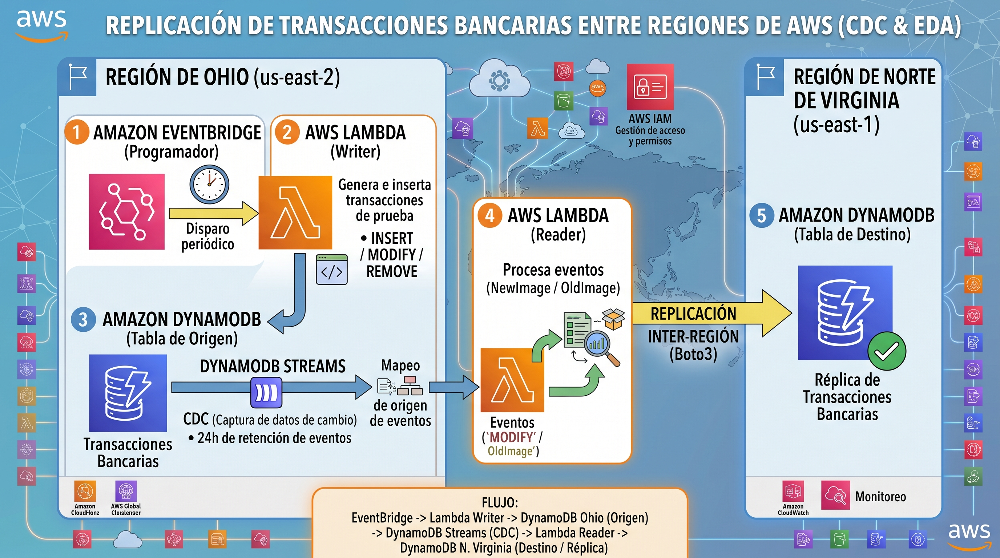

# 🌎 Proyecto Real Time #2 — Replicación Multirregional con DynamoDB Streams + Lambda

> 📦 Arquitectura orientada a eventos que implementa un mecanismo de **replicación de transacciones bancarias entre dos regiones de AWS**, utilizando **Amazon DynamoDB**, **DynamoDB Streams** y **AWS Lambda** para detectar, procesar y replicar cambios de una tabla principal en Ohio (`us-east-2`) hacia una tabla secundaria en Norte de Virginia (`us-east-1`).


---

## 📌 Contexto

El proyecto consiste en construir una arquitectura basada en eventos (**Event-Driven Architecture**) que permita mantener una réplica de las transacciones bancarias registradas en una tabla de DynamoDB ubicada en la región de **Ohio (`us-east-2`)**.

Para ello, aprovecharemos **DynamoDB Streams**, una funcionalidad nativa de DynamoDB que permite capturar los cambios realizados sobre los elementos de una tabla, implementando un mecanismo de **Change Data Capture (CDC)**.

Estos eventos serán procesados por una función **AWS Lambda**, desplegada en la misma región que el Stream, cuya responsabilidad será identificar las operaciones realizadas (`INSERT`, `MODIFY` y `REMOVE`) y replicarlas mediante Boto3 en una segunda tabla de DynamoDB ubicada en **Norte de Virginia (`us-east-1`)**.

Adicionalmente, utilizaremos **Amazon EventBridge** para programar la ejecución de una segunda función Lambda, encargada de generar e insertar transacciones de prueba en la tabla principal.

---
### 🏗️ Arquitectura



**Flujo:** EventBridge ejecuta periódicamente la Lambda Writer → Lambda Writer genera e inserta transacciones en DynamoDB (Ohio) → DynamoDB Streams captura los cambios (24 horas de retención) → Event Source Mapping invoca la Lambda Reader  (Ohio) → Lambda Reader procesa los eventos (`NewImage` / `OldImage`) y escribe los cambios en la tabla secundaria de DynamoDB (Norte de Virginia).

---


## 🗂️ Fase 1 — Creación de la tabla en DynamoDB

Accedemos al servicio de Amazon DynamoDB y seleccionamos:

```yml
    Amazon DynamoDB
      → Tables
        → Create Table
```
### 1. Configuración de la tabla

| Parámetro | Valor |
|---|---|
| Nombre | `transactions` |
| Partition Key (PK) | `transaction_id` (String) |
| Sort Key (SK) | `No se define`|
| Table settings | Customize settings |
| Table class | DynamoDB Standard |
| Capacity mode | On-Demand *(evita la complejidad inicial de gestionar capacidad manual)* |

> El resto de configuraciones se dejan por defecto.

---

### 2. Esquema de datos a registrar

Mantendremos la siguiente estructura para los datos que se almacenarán en la tabla:

| Atributo | Tipo DynamoDB | Descripción |
| :--- | :--- | :--- |
| `transaction_id` | String | Identificador único de la transacción |
| `account_id` | String | Identificador de la cuenta bancaria |
| `transaction_date` | String | Fecha y hora de la transacción |
| `transaction_type` | String | Tipo de transacción |
| `amount` | Number | Importe de la operación |
| `currency` | String | Moneda utilizada |
| `status` | String | Estado de la transacción |
| `description` | String | Descripción de la operación |
| `channel` | String | Canal por el que se realizó |
| `created_at` | String | Fecha de registro |
| `updated_at` | String | Fecha de última actualización |

> Esta será la estructura que mantendremos para la información que serpa almacenada. En este caso, la información será generada en la lambda function (lo veremos mas adelante).
---

### 3.⚡ Habilitar DynamoDB Streams

DynamoDB Streams es una funcionalidad que permite capturar, de forma ordenada y en tiempo real, las modificaciones realizadas sobre los ítems de una tabla (`INSERT`, `UPDATE`, `DELETE`). Trabaja bajo el patrón **CDC** y arquitecturas orientadas a eventos.

**Características clave:**
- 🕐 Retiene los cambios generados durante **24 horas**.
- 🚫 No impacta en la capacidad de lectura/escritura de la tabla.

**Pasos:**
1. Ir a la pestaña **Exports and streams** → sección *DynamoDB stream details*.
2. Click en **Turn on**.
3. Seleccionar **New and old images** como *view type*.

Esta opción permite conservar ambas versiones de cada registro modificado: el estado previo (**old image**) y el estado posterior (**new image**) a un cambio.

Otras opciones disponibles del *view type*:

| Opción | Descripción |
|---|---|
| **Key attributes only** | Solo registra los atributos clave (PK/SK) del ítem modificado. |
| **New image** | Registra únicamente el estado nuevo del ítem tras el cambio. |
| **Old image** | Registra únicamente el estado previo del ítem antes del cambio. |
| **New and old images** ✅ | Registra ambos estados (el elegido en este proyecto). |

Una vez habilitado, en la misma sección se genera un **ARN** (Amazon Resource Name): este identifica el *stream* donde se están registrando los cambios de los ítems de la tabla, y será el recurso que la función Lambda deberá leer para procesar dichos cambios.

> 💡 Un *stream* es un flujo continuo de datos que crece constantemente en base a la información que se va almacenando (en este caso, los cambios de ítems en DynamoDB).

---

## 🗂️ Fase 2 — Creación de la Lambda Function (Ingesta de datos)

Accedemos al servicio de AWS Lambda y seleccionamos:

```yml
    AWS Lambda
      → Functions
        → Create function
```

### 1. Configuración inicial

| Parámetro | Valor |
|---|---|
| Nombre | `lambda-writer-table-transactions-dynamo` |
| Runtime | Python 3.15 |
| Rol de IAM | Autogenerado por defecto (permisos iniciales solo para escribir logs en CloudWatch) |

---

### 2. 🔐 Ampliación de permisos del rol de ejecución

El rol autogenerado por Lambda solo permite escribir logs en CloudWatch, por lo que es necesario añadir permisos adicionales para que la función pueda escribir en la tabla `transactions` definida previamente en DynamoDB.

Accedemos a la lambda function creada y nos dirigimos a:
```yml
Configuration
   → Permissions
     → Role name (en mi caso: lambda-writer-table-transactions-dynamo-role-xeoyj5th)
       → redirige a IAM 
```
Una vez dentro del rol en el servicio IAM, nos dirigimos a:
```yml
Permissions policies
   → Add permissions 
     → Create inline policy.
```

Luego, elegiremos **JSON** en Policy editor y pegaremos la policita en formato JSON:

```json

{
    "Version": "2012-10-17",
    "Statement": [
        {
            "Sid": "WriteOnTableTransactions",
            "Effect": "Allow",
            "Action": [
                "dynamodb:PutItem"
            ],
            "Resource": [
                "<ARN de la tabla DynamoDB>"
            ]
        }
    ]
}

```

> ⚠️ El valor de `Resource` debe reemplazarse por el ARN generado al activar DynamoDB Streams en la tabla.

Damos click en **Next** y en policy name: `Policy-Lambda-Write-to-DynamoDB`. 

Finalmente, damos click en **Create policy**

---

### 3. 💻 Código de la Lambda (Ingesta de datos)

Accedemos a la lambda function creada y nos dirigimos a **Code**, donde encontraremos un editor
similar a Visual Studio Code. Aquí, vmos a borrar el código por defecto y pegaremos el siguiente:

[`lambda-writer-table-transactions-dynamo.py`](./assets/lambda-writer-table-transactions-dynamo.py)

Posteriormente, daemos click en `Deploy (Ctrl+Shift+U)`. De esta manera, la lambda function estará lista para la ingesta de datos en la tabla DynamoDB. Sin embargo, aún falta definir como se activará la lambda function.

---

## 🗂️ Fase 3 — Amazon Eventbridge (Activa Lambda Function)

### 📡 Amazon EventBridge

  En esta etapa se implementa un mecanismo de automatización que permite ejecutar la función Lambda de manera programada, simulando la generación periódica de datos en la tabla `transactions` de DynamoDB.

  Para este caso, se utiliza la funcionalidad de **EventBridge Scheduler**, la cual permite definir ejecuciones recurrentes sin necesidad de administrar infraestructura adicional.

  * Parámetros de configuración - Schedule:
    * Nombre del schedule: `schedule-lambda-write-to-table-dynamodb`
    * Schedule group: **Default**
    * Schedule pattern: 
      * `Recurring schedule`
      * Time zone: **(UTC-05:00) America/Lima**
      * Schedule type: **Rate-based schedule** ➡️ **rate(1 day)**
      * Flexible time window: **Off**
    * Timeframe:
      
      - Star date and time: **13/11/2026** ➡️ **17:00**
      - Star date and time: **14/11/2026** ➡️ **17:00**

      >>Para el ejemplo de simulación de este proyecto, la fecha de inicio fue el día 13/11/2026 a las 17:00 y la fecha de termino 14/11/2026 a las 17:00.
    * Damos click en **Next**
  * Seleccionamos destino del evento:
    * Target API: **AWS Lambda**
    * Invoke: 
      * Lambda function: **lambda-writer-table-transactions-dynamo** ⬅️ Función creada anteriormente
      * Payload: `No se agrega nada`
    * Damos click en **Next**
  * Schedule state: **Enable**
  * Action after schedule completion: **NONE** ⬅️Evitará eliminar el schedule una vez ejecutado.
  * Retry policy and dead-letter queue (DLQ): **NONE**
  * Encryption: No marcamos esta opción y dejamos que AWS se encargue del crifrado
  * Permissions:
    * Create new rol for this schedule ⬅️ Crearemos el rol para que EventBridge, aplicando el principio de mínimo privilegio, pueda ejecutar la lambda function definida de forma segura.
  * Damos click en **Next** y luego en **Create schedule**
  * Ahora solo esperamos que el schedule se ejecute y active la lambda, basandose en las configuraciones del **Timeframe**

* 🎯 Resultado de esta etapa

  Con esta configuración se logra:

  * Simular datos diarios de una aplicación
  * Alimentar continuamente la tabla `transactions` en DynamoDB

>> Asimismo, en la lambda function `lambda-writer-table-transactions-dynamo` se agregará automáticamente un trigger que activará la lambda, en este caso, el schedule definido en esta fase.

---

## 🗂️ Fase 4 — Creación de la tabla que replicará información en DynamoDB

Cambiamos de región:
```yml
    Miremos el ícono ⚙️ en la parte superior derecha.
      → A lado, aparecerá el nombre de la región por defecto
        (en mi caso United States - Ohio)
        → Damos click y seleccionamos: United States (N. Virginia)
```
Accedemos al servicio de Amazon DynamoDB y seleccionamos:

```yml
    Amazon DynamoDB
      → Tables
        → Create Table
```
### 1. Configuración de la tabla

| Parámetro | Valor |
|---|---|
| Nombre | `transactions_back_us_east_1` |
| Partition Key (PK) | `transaction_id` (String) |
| Sort Key (SK) | `No se define`|
| Table settings | Customize settings |
| Table class | DynamoDB Standard |
| Capacity mode | On-Demand *(evita la complejidad inicial de gestionar capacidad manual)* |

> El resto de configuraciones se dejan por defecto. Damos click en Create table.

## 🗂️ Fase 5 — Creación de la Lambda Function (Lectura y Escritura de datos)

Cambiamos de región:
```yml
    Miremos el ícono ⚙️ en la parte superior derecha.
      → A lado, aparecerá el nombre de la región por defecto
        (en mi caso United States - N. Virginia)
        → Damos click y seleccionamos: United States (Ohio)
```

Accedemos al servicio de AWS Lambda y seleccionamos:

```yml
    AWS Lambda
      → Functions
        → Create function
```

### 1. Configuración inicial

| Parámetro | Valor |
|---|---|
| Nombre | `lambda-reader-table-transactions-dynamodb` |
| Runtime | Python 3.15 |
| Rol de IAM | Autogenerado por defecto (permisos iniciales solo para escribir logs en CloudWatch) |

---

### 2. 🔐 Ampliación de permisos del rol de ejecución

El rol autogenerado por Lambda solo permite escribir logs en CloudWatch, por lo que es necesario añadir permisos adicionales para que la función pueda leer el stream de DynamoDB y escribir la información en la tabla de réplica (se creará mas adelante).

Accedemos a la lambda function creada y nos dirigimos a:
```yml
Configuration
   → Permissions
     → Role name (en mi caso: lambda-reader-table-transactions-dynamo-role-9wl2xtmp)
       → redirige a IAM 
```
Una vez dentro del rol en el servicio IAM, nos dirigimos a:
```yml
Permissions policies
   → Add permissions 
     → Create inline policy.
```

Luego, elegiremos **JSON** en Policy editor y pegaremos la policita en formato JSON:

```json
{
  "Version": "2012-10-17",
  "Statement": [
    {
        "Sid": "ReadStreamTableTransactionsUsEast2",
        "Effect": "Allow",
        "Action": [
            "dynamodb:GetRecords",
            "dynamodb:GetShardIterator",
            "dynamodb:DescribeStream",
            "dynamodb:ListStreams"
        ],
        "Resource": "<ARN del stream de la tabla DynamoDB (transactions)>"
    },
    {
        "Sid": "WriteOnTableTransactionsBackUsEast1",
        "Effect": "Allow",
        "Action": [
            "dynamodb:PutItem",
            "dynamodb:DeleteItem"
        ],
        "Resource": [
            "<ARN de la tabla DynamoDB (transactions_back_us_east_1)>"
        ]
    }
  ]
}
```

> ⚠️ El valor de `Resource` debe reemplazarse por el ARN generado al activar DynamoDB Streams en la tabla.

Damos click en **Next** y en policy name: `Policy-Lambda-Read-Write-to-Table-DynamoDB`. 

Finalmente, damos click en **Create policy**

---

### 3. 💻 Código de la Lambda (Lectura y escritura de datos)

Accedemos a la lambda function creada y nos dirigimos a **Code**, donde encontraremos un editor
similar a Visual Studio Code. Aquí, vmos a borrar el cóigo por defecto y pegaremos el siguiente:

[`lambda-reader-table-transactions-dynamo.py`](./assets/lambda-reader-table-transactions-dynamo.py)


### 4. ⚙️ Configuración del Trigger (Event Source Mapping)

* El trigger en AWS Lambda es una de las formas mas comunes de activar una Lambda Function, y, para este caso
utilizaremos el trigger de **DynamoDB**. Nos digirimos al diagrama de la lambda y seleccionaremos **Add trigger**

> Para el caso de DynamoDB + Lambda, el propio servicio de Lambda ejecuta internamente un proceso llamado **Event Source Mapping**, el cual lee continuamente el *shard* del stream de la tabla DynamoDB para su posterior procesamiento.

```yml
Select a source 
  → DynamoDB 
    → DynamoDB table
      → transactions (apuntando al ARN de su stream).
```
Adicionalmente, realizaremos las siguientes configuraciones:

| Parámetro | Valor elegido | Motivo |
|---|---|---|
| Activate trigger | ✅ Activado | El trigger se dispara automáticamente al crearse. |
| Enable EventCount metrics | ✅ Activado | Permite monitorear cuánta información individual del stream se procesa. |
| Batch size | `10` | Agrupa en lotes de 10 eventos cuando llegan múltiples cambios consecutivos. |
| Starting position | `Latest` | Solo procesa eventos generados a partir de la creación del trigger (se descarta `Trim horizon` para este proyecto). |

Al finalizar la configuración:

```
✅ The trigger pedidos was successfully added to function lambda-procesar-pedidos.
```

---

## ✅ Resultado final

Se logró construir una arquitectura completamente orientada a eventos (**Event-Driven Architecture**), 100% **serverless**, integrando de forma desacoplada:

- **DynamoDB Streams** como mecanismo de CDC.
- **AWS Lambda** como procesador de eventos.
- **Amazon EeventBridge** como programador de tareas para simular cargas de trabajo diarias y acivar Lambda Function.

Este proyecto representa el segundo acercamiento práctico a DynamoDB Streams dentro del camino hacia la certificación **AWS Solutions Architect Associate**.

---